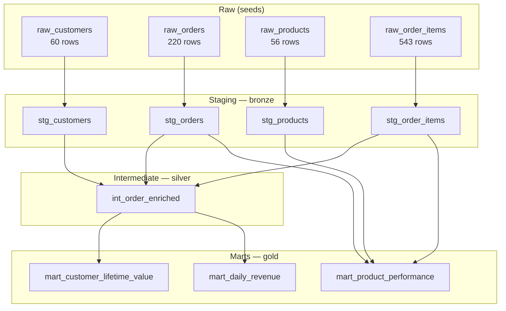

# E-commerce Analytics with dbt

An end-to-end **analytics engineering** project built with dbt: raw e-commerce
extracts are cleaned, conformed, and modeled into analytics-ready marts using a
medallion-style layered architecture. Runs locally on **DuckDB** with zero
credentials; the SQL is portable and the project ships with a **Snowflake**
profile for production use.

## What it does

Takes four raw tables (customers, orders, products, order line items) and
produces three business-facing marts:

| Mart | Grain | Purpose |
|---|---|---|
| `mart_customer_lifetime_value` | one row per customer | CLV, order counts, recency |
| `mart_daily_revenue` | one row per date | revenue trend reporting |
| `mart_product_performance` | one row per product | units, revenue, gross margin |

Only *fulfilled* orders (`completed`, `shipped`) contribute to revenue metrics —
cancelled, pending and returned orders are excluded by design.

## Architecture



## Tech stack

- **dbt Core** with the **dbt-duckdb** adapter (local, file-based — no warehouse needed)
- SQL written to be **Snowflake-portable** (standard functions only)
- Sample data generated as versioned CSV seeds

## Quickstart

```bash
# 1. Install
pip install -r requirements.txt

# 2. Load the sample data
dbt seed --profiles-dir .

# 3. Build all models
dbt run --profiles-dir .

# 4. Run all 49 data tests
dbt test --profiles-dir .

# 5. Explore the docs & lineage graph
dbt docs generate --profiles-dir . && dbt docs serve --profiles-dir .
```

> `--profiles-dir .` tells dbt to use the `profiles.yml` in this repo.
> The DuckDB database file (`dev.duckdb`) is created in the project root.

## Project structure

```
├── dbt_project.yml            # project config, layer materializations & schemas
├── profiles.yml               # local DuckDB target (see below for Snowflake)
├── requirements.txt           # dbt-duckdb
├── seeds/                     # raw CSV extracts loaded via `dbt seed`
│   ├── raw_customers.csv
│   ├── raw_orders.csv
│   ├── raw_products.csv
│   └── raw_order_items.csv
├── models/
│   ├── staging/               # bronze: 1:1 with sources, light cleaning only
│   │   ├── sources.yml
│   │   ├── stg_customers.sql / stg_orders.sql / ...
│   │   └── schema.yml         # column docs + generic tests
│   ├── intermediate/          # silver: shared conformed building blocks
│   │   ├── int_order_enriched.sql
│   │   └── schema.yml
│   ├── marts/                 # gold: business-facing tables
│   │   ├── mart_customer_lifetime_value.sql
│   │   ├── mart_daily_revenue.sql
│   │   ├── mart_product_performance.sql
│   │   └── schema.yml
│   ├── docs.md                # docs blocks for key models
│   └── macros/
│       └── generate_schema_name.sql   # clean schema names (no prefixing)
└── tests/                     # custom singular tests
    ├── assert_order_total_matches_line_items.sql
    └── assert_positive_unit_prices.sql
```

## Modeling decisions

**Why medallion (bronze → silver → gold)?** Each layer has one job. Staging
mirrors sources with only type-casting and renaming, so raw-to-clean mapping
stays obvious. The intermediate layer (`int_order_enriched`) centralizes the
order ↔ customer ↔ line-item joins once, so every mart inherits identical
definitions instead of re-implementing joins. Marts contain only business logic
and aggregation.

**Staging is views, marts are tables.** Staging models are cheap pass-through
views; marts are materialized as tables since they power dashboards and are
read far more often than rebuilt.

**Fulfilled-orders rule lives in the marts, not the intermediate layer.**
`int_order_enriched` keeps *all* orders so analysts can still study cancellations
and returns; each mart filters to `completed`/`shipped` for revenue metrics.

**Grain choices:** CLV is per-customer (a classic customer-360 shape);
daily revenue is per-date for trend charts; product performance is per-product
with a left join so products with no fulfilled sales still appear.

## Testing strategy

49 tests, all passing, across three layers of defense:

1. **Generic tests on every model** (`schema.yml`): `unique` + `not_null` on all
   primary keys, `relationships` on every foreign key, `accepted_values` on
   `status` and `category` — so broken joins and bad codes fail the build.
2. **Singular reconciliation test**
   (`assert_order_total_matches_line_items`): the recorded `order_total` on
   every order header must equal the sum of its line items within 1 cent —
   the kind of finance-reconciliation check that catches real pipeline bugs.
3. **Singular sanity test** (`assert_positive_unit_prices`): no negative prices
   or costs in the catalog.

## Pointing it at Snowflake

The SQL uses only portable functions, so moving to Snowflake is a profile
change. Replace `profiles.yml` with:

```yaml
ecommerce_analytics:
  target: prod
  outputs:
    prod:
      type: snowflake
      account: <your_account>        # e.g. xy12345.us-east-1
      user: <your_user>
      password: <your_password>      # or use key-pair auth
      role: <your_role>
      database: <your_database>
      warehouse: <your_warehouse>
      schema: <your_schema>
      threads: 4
```

Then swap `dbt seed` for your real ingestion (Fivetran, Airbyte, Snowpipe, or
`COPY INTO`) landing tables named `raw_customers`, `raw_orders`,
`raw_products`, `raw_order_items` in the `raw` schema — the `sources.yml`
definition already points there.

## License

MIT — see [LICENSE](LICENSE).
